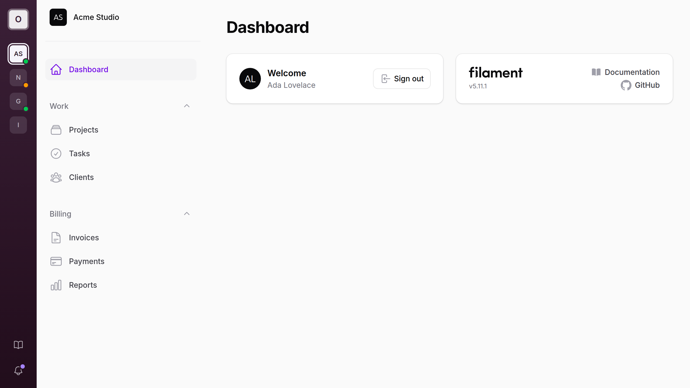

# Rail for Filament

[](https://packagist.org/packages/filafly/filament-rail)
[](https://packagist.org/packages/filafly/filament-rail)

A slim icon rail for Filament panels: your logo, tenant switching, and quick links in a dark column beside the sidebar.

Docs and screenshots: [filafly.com/plugins/filament-rail](https://filafly.com/plugins/filament-rail?utm_source=github&utm_medium=readme&utm_campaign=rail)

In a multi-tenant panel the rail becomes the home for tenancy. Every tenant the user belongs to is a tile, the current one is marked, and the rail can take on each tenant's brand color. On desktop it replaces the sidebar's tenant menu. On smaller screens it steps aside and Filament's own controls come back.



## Requirements

- PHP 8.2+
- Filament v4 or v5 (tested with 4.16 on Laravel 12 and 5.11 on Laravel 13)

## Installation

You can install the package via Composer:

```bash
composer require filafly/filament-rail
```

Publish the assets:

```bash
php artisan filament:assets
```

Register the plugin in your panel provider:

```php
use Filafly\Rail\RailPlugin;

public function panel(Panel $panel): Panel
{
    return $panel
        ->plugin(RailPlugin::make());
}
```

## What the rail shows

From top to bottom:

1. A logo tile linking to the panel's home page.
2. A tile for each of the user's tenants, followed by a tile to register a new tenant when the panel allows it.
3. Links pinned to the bottom: the tenant menu's links (such as the tenant profile and billing), your own items, and the database notifications bell.

Every icon has a tooltip. The rail sits on a dark surface in both light and dark mode, tinted with the panel's primary color.

## Tenancy

With tenancy enabled on the panel, the rail lists every tenant returned by your user's `getTenants()`. Each tile shows the tenant's avatar when the model implements `HasAvatar`, and its initials otherwise. Clicking a tile switches to that tenant.

On desktop, the sidebar's tenant menu is hidden, since the rail covers it.

### `tenantStatus(?Closure $callback)`

Adds a status dot to each tenant tile. The closure receives the tenant as `$tenant` and returns a panel color name, or `null` for no dot.

```php
RailPlugin::make()
    ->tenantStatus(fn (Team $tenant): ?string => match ($tenant->status) {
        'active' => 'success',
        'paused' => 'warning',
        default => null,
    })
```

### `color(string | Closure | null $color)`

Tints the whole rail with any CSS color. The closure receives the current tenant as `$tenant`, so each tenant can carry its own brand. Return `null` to keep the default.

```php
RailPlugin::make()
    ->color(fn (?Team $tenant): ?string => $tenant?->brand_color)
```

### `tenantMenuInSidebar(bool $condition = true)`

Keeps Filament's tenant menu in the sidebar on desktop as well.

### `tenants(bool $condition = true)`

Pass `false` to leave tenants out of the rail entirely. The sidebar's tenant menu then stays where Filament puts it.

### Tenant menu links

Filament's tenant menu items that link somewhere appear in the rail: the registration link becomes a tile after the tenants, and the rest (the tenant profile, billing, and your own tenant menu items) join the links at the bottom. They follow Filament's visibility rules, so a user who cannot edit the tenant profile does not see its link.

Tenant menu items that run an action instead of linking somewhere are not shown in the rail.

## Brand

### `logo(string | Closure | null $url)`

The image in the rail's logo tile. Defaults to the panel's favicon, then to the first letter of the brand name.

```php
RailPlugin::make()
    ->logo(asset('images/logo-mark.svg'))
```

### `sidebarBrand(bool $condition = true)`

With the rail carrying the app's identity, the panel's own logo beside it can be redundant. Pass `false` to hide it on desktop. The sidebar header keeps its collapse button, and the topbar's logo is hidden too when the panel has a topbar.

```php
RailPlugin::make()
    ->sidebarBrand(false)
```

### `sidebarTenant(bool $condition = true)`

Shows the current tenant's avatar and name in the brand's place on desktop, linking to the tenant's home page. The brand is hidden there while it does. A tenant implementing `HasCurrentTenantLabel` shows its label above the name, as in Filament's tenant menu.

```php
RailPlugin::make()
    ->sidebarTenant()
```

On smaller screens, where the rail is hidden, the panel's brand always shows.

## Links

### `items(array | Closure $items)`

Pins navigation items to the bottom of the rail. They take an icon, an active icon, `isActiveWhen()`, `visible()`, and URLs that open in a new tab. An item with a badge shows a dot.

```php
use Filament\Navigation\NavigationItem;
use Filament\Support\Icons\Heroicon;

RailPlugin::make()
    ->items(fn (): array => [
        NavigationItem::make('Settings')
            ->icon(Heroicon::OutlinedCog6Tooth)
            ->url(fn (): string => Settings::getUrl())
            ->isActiveWhen(fn (): bool => request()->routeIs('filament.admin.pages.settings')),
        NavigationItem::make('Documentation')
            ->icon(Heroicon::OutlinedBookOpen)
            ->url('https://example.com/docs', shouldOpenInNewTab: true),
    ])
```

Pass a closure when an item's URL depends on the current tenant or request.

## Notifications

When the panel has `databaseNotifications()`, the rail shows a bell that opens Filament's notifications panel, with a dot when there are unread notifications. Filament's own bell, in the sidebar or the topbar, is hidden on desktop.

The dot reflects the unread count when the page loads.

### `notifications(bool $condition = true)`

Pass `false` to leave the bell out of the rail.

## Auth pages

The rail is hidden on the login, registration, password reset and email verification pages, and on a simple profile page, since those pages have no sidebar for it to sit beside.

### `onAuthPages(bool $condition = true)`

Shows the rail on those pages too.

## Smaller screens

The rail shows from Filament's `lg` breakpoint (`64rem`) up. Below that the sidebar is a drawer, and it keeps Filament's own controls: the tenant menu and the notifications bell come back, and the rail's `items()` are repeated at the bottom of the sidebar navigation.

## Theming

The rail reads a few CSS custom properties, which a theme can override:

| Property | Default | Purpose |
| --- | --- | --- |
| `--fi-rail-width` | `68px` | Width of the rail |
| `--fi-rail-from` | Primary 950, darkened | Top of the rail's gradient |
| `--fi-rail-to` | Primary 950, darkened further | Bottom of the rail's gradient |
| `--fi-rail-foreground` | Near-white | Icons, initials and the active tile |

```css
:root {
    --fi-rail-width: 72px;
}
```

A rail tinted with `color()` derives its gradient from the tint instead.

## Full Example

```php
use Filafly\Rail\RailPlugin;
use Filament\Navigation\NavigationItem;
use Filament\Support\Icons\Heroicon;

->plugin(
    RailPlugin::make()
        ->logo(asset('images/logo-mark.svg'))
        ->tenantStatus(fn (Team $tenant): ?string => $tenant->status->getColor())
        ->color(fn (?Team $tenant): ?string => $tenant?->brand_color)
        ->sidebarTenant()
        ->items(fn (): array => [
            NavigationItem::make('Documentation')
                ->icon(Heroicon::OutlinedBookOpen)
                ->url('https://example.com/docs', shouldOpenInNewTab: true),
        ])
)
```

## Testing

```bash
composer test
```

`npm test` runs the same suite (after `composer update`); it exists so the ship gate can find the tests, and `package.json` is left out of Composer installs.

## From FilaFly

FilaFly makes premium themes for Filament panels: Lucent, Prizm, Cypher and Citrus. [Browse the themes](https://filafly.com/themes?utm_source=github&utm_medium=readme&utm_campaign=rail).

## Credits

- [Nolan Nordlund](https://github.com/nolanos)
- [All Contributors](../../contributors)

## License

The MIT License (MIT). Please see [License File](LICENSE.md) for more information.
